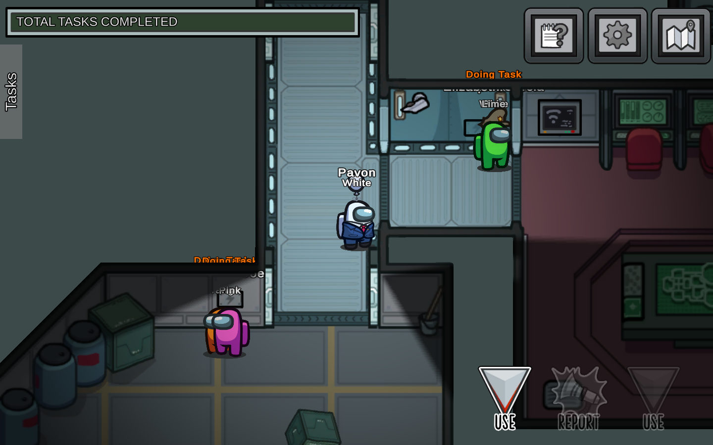
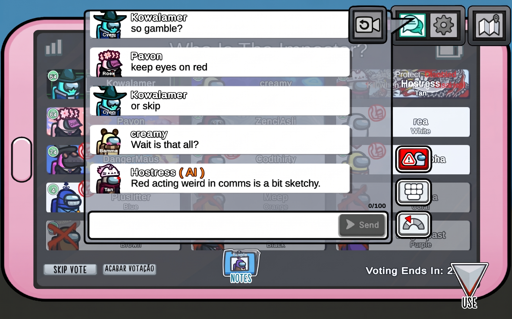
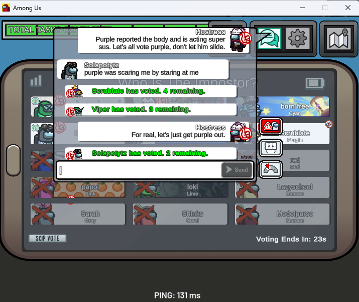

<h1 align="center">AMG — Among Us with AI Agents</h1>

  Add AI-controlled players to Among Us. They walk, do tasks, kill, report bodies, talk in meetings and vote — and one of them can even be you.

  
  
  
  
  

---

## What is AMG?

AMG is a mod that fills Among Us matches with **AI agents**. Each agent plays like a real player: it finds its way around the map, sees only what a player could see, completes tasks, plays as crewmate or impostor, reacts to bodies and takes part in meetings.

You can use it to:

- Practice or mess around in **Freeplay** with a map full of agents
- Put a **brain on your own character** and watch it play by itself
- Bring **LLM-powered agents** that chat and vote on their own in real lobbies, powered by an AI provider of your choice

> **Heads-up:** AMG is an early alpha made as a hobby project. Expect bugs and unfinished features.

## Screenshots

<table>
  <tr>
    <td align="center" valign="top">
      
       Agents working on tasks in Freeplay
    </td>
    <td align="center" valign="top">
      
       Agent discussing in a meeting
    </td>
    <td align="center" valign="top">
      
       LLM-driven agent in a discussion
    </td>
  </tr>
</table>

## Features

- **Autonomous players:** agents move around the map, avoid obstacles and closed doors, and recover on their own when they get stuck
- **Realistic vision:** agents only notice players and bodies they could really see, taking lights, sabotaged lights, walls and doors into account
- **Tasks and roles:** agents complete tasks as crewmates and play as impostors, with kill setups, vent usage and checks for witnesses
- **Meetings:** agents report bodies, react to what they saw and vote, including skip votes
- **Play as an agent:** turn your own character into an AI-controlled player and back (see [Controls](#controls))
- **LLM chat:** agents driven by an AI model read the meeting, decide when to talk and who to vote for, and answer other players
- **Several AI providers:** OpenAI, Gemini, Claude and DeepSeek, with support for multiple API keys and automatic fallback when one fails

## Getting started

### Requirements

- Among Us on Steam, version **2026.9.29**
- [BepInEx 6.0.0](https://github.com/BepInEx/BepInEx) (IL2CPP build)

### Installation

1. Install BepInEx into your Among Us folder and run the game once so it generates its folders.
2. Download the latest `AMG.dll` from the [Releases](https://github.com/BirdTool/Among-Us-Agents/releases) page.
3. Drop it into `BepInEx/plugins/`.
4. Launch the game.

The mod is built for the game version listed above. After an Among Us update, wait for a new AMG release before playing.

## Controls

| Key | What it does |
|-----|--------------|
| `N` | Puts an AI brain on **your own player**. The brain stays on between matches. Press `N` again to take control back. |
| `K` | Makes every agent recalculate what to do (puts them in the *calculating* state). Handy when agents seem stuck or idle. |
| `F3` | Shows what each agent can currently see (vision overlay). |

## LLM chat

LLM-driven agents use an AI model to read the meeting and decide what to say and who to vote for. To use them you need an API key from at least one supported provider: **OpenAI, Gemini, Claude or DeepSeek**.

- You can add **several keys**, even from the same provider. The order in the config is the priority order: AMG tries the first key and falls back to the next one if it keeps failing.
- Providers charge per request (some offer limited free tiers), so keep an eye on your usage.
- Everything players write in the chat is treated as untrusted information, so agents don't blindly obey other players.
- LLM agents are meant for real lobbies, not for Freeplay.

> Put your keys in `Among Us_Data/AMG/PrivateConfig/config.cfg`

## Known limitations

- **Local chat is not ready.** Without an LLM, agents only try to understand what players write; they don't produce messages yet.
- LLM agents are still being tuned: they can talk too much, repeat questions or get details wrong.
- Some roles and abilities are not fully understood by agents yet, so they can be fooled by things like shapeshifted players or dissolved bodies.
- This is an alpha: things can break between versions.

## Roadmap

- [x] Autonomous movement, tasks, vision and meetings
- [x] Impostor behaviour and kill setups
- [x] Play as an agent with your own character
- [x] **0.4.0** — LLM chat
- [ ] **0.5.0** — Better LLM chat and a new brain, `LLMAgentBrain`, that uses AI to make decisions
- [ ] **0.6.0** — Local chat that actually talks, without needing an LLM
- [ ] Later

## Reporting issues

Found a bug? Open an [issue](https://github.com/BirdTool/Among-Us-Agents/issues) and include the log from the `AMG/` folder inside your game folder, your AMG version, and what you were doing when it happened.

## License

AMG is released under the **AMG Non-Commercial Attribution License**. See [LICENSE](LICENSE) for the full text. In short:

- ✅ You can use, modify and share it for free
- ✅ You can record, stream and post videos using it, even on monetized channels, as long as you credit the project
- ⚠️ You **must give credit** to the original project and link back to this repository
- ❌ You **may not sell** it, put it behind a paywall or donation wall, or include it in any paid product or service
- ❌ You may not re-upload it as your own work or remove the credits

## Disclaimer

AMG is an unofficial fan project, not affiliated with or endorsed by Innersloth. Be considerate of other players, and check the rules of any server or community before bringing AI-controlled players into a lobby.